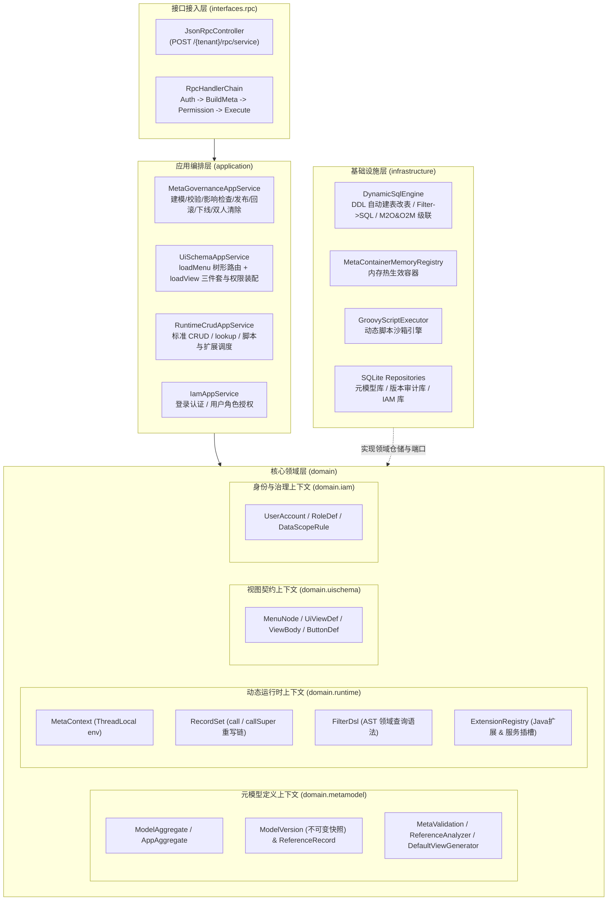
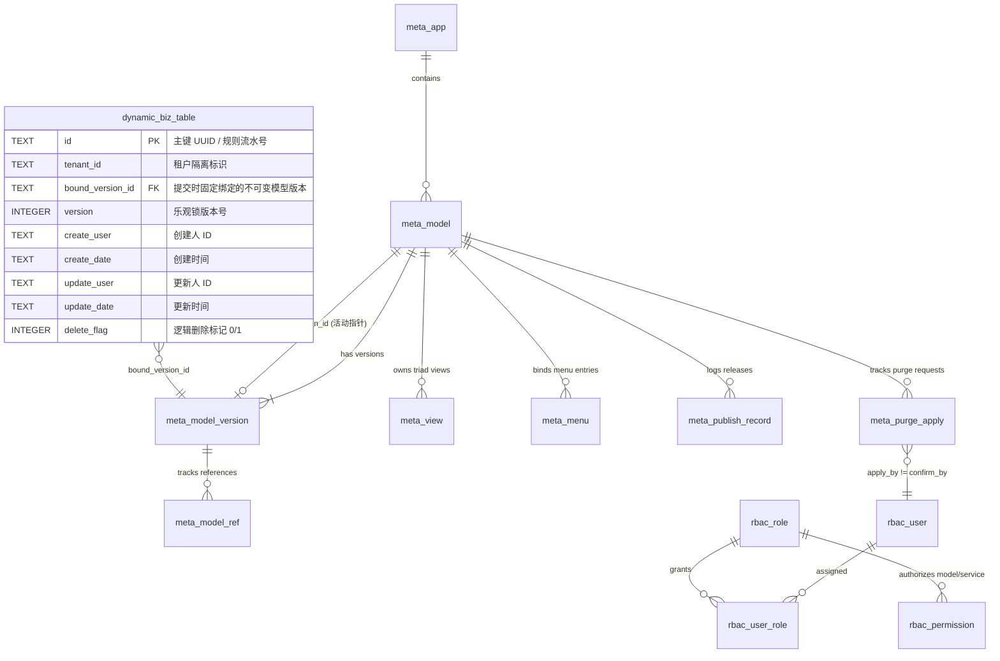

# DDD 领域建模与数据模型设计说明书
## 模型驱动开发的低代码平台（Java + DDD + JSON-RPC 2.0）

**文档版本**：v3.0（推倒重建版 — 严格 DDD 四层架构与 `iidp-backend-demo` 元模型对齐）  
**基线参考**：`D:\MES\iidp-backend-demo` (`sie-snest-engine`, `sie-snest-sdk`, `sie-iidp-dev-center`, `sie-iidp-iam`)

---

## 1. 领域驱动设计 (DDD) 战略设计

### 1.1 统一语言 (Ubiquitous Language)
| 领域术语 | 代码抽象标识 | 对标 `sie-snest-engine` | 语义边界说明 |
| :--- | :--- | :--- | :--- |
| **应用** | `AppAggregate` | `AppMeta` (`app.json`) | 元模型打包与发布的逻辑单元，汇聚所属模型、菜单、视图与依赖声明。 |
| **模型** | `ModelAggregate` | `ModelMeta` (`@Model`) | 描述一类业务实体的元模型聚合根，拥有唯一的生效版本指针及生命周期状态。 |
| **模型版本** | `ModelVersion` | `VersionSnapshot` / Tag | 模型在特定版本的**不可变定义快照**，包含该版本完整的属性集、视图、服务契约。 |
| **属性** | `PropertyDef` | `PropertyMeta` (`@Property`) | 模型字段的元数据描述（类型、物理列名、展示名、约束、默认值、ER关系）。 |
| **模型服务** | `ServiceDef` | `ServiceMeta` / `@MethodService` | 模型暴露的能力契约，含内置 CRUD、Groovy 脚本服务、声明式状态转移或 Java 扩展。 |
| **三件套视图** | `UiViewDef` | `UiViewMeta` (`views/*.json`) | 描述同一模型的 `grid`（表格）、`search`（搜索区）、`form`（表单及 `tabs` 子表）契约。 |
| **菜单元数据** | `MenuNode` | `MenuMeta` (`menus.json`) | 驱动前端动态侧边栏与动态前端路由的树形结构，连接菜单到模型与视图组。 |
| **执行上下文** | `MetaContext` | `Meta` (`self.env`) | 绑定当前请求线程的环境句柄，携带身份、租户、语言、事务与 `get(model)` 入口。 |
| **记录集句柄** | `RecordSet` | `RecordSet` | 面向任意模型的统一运行时操作句柄，通过 `call(method, args)` 与 `callSuper(...)` 调度服务。 |
| **查询域 DSL** | `FilterDsl` | `Filter` (`[["k","op",v]]`) | 与数据库无关的前后端统一波兰表达式查询语言，在运行时编译为参数化 SQL。 |
| **引用依赖图** | `ReferenceRecord` | `meta_model_ref` | 记录字段被视图列、搜索项、表单字段、按钮条件、校验规则与外键关系的引用位置。 |

### 1.2 限界上下文与四层分层架构

平台内部划分为四个边界清晰、职责正交的核心与通用限界上下文，并严格落地为四层包结构（`interfaces` -> `application` -> `domain` -> `infrastructure`）：

### 1.3 上下文协作模式
1. **MetaModelContext <-> RuntimeContext**（客户-供应方模式）：`MetaModelContext` 在发布时产出经过验证的不可变 `ModelVersionSnapshot` 供 `RuntimeContext` 装载至内存注册表；`RuntimeContext` 根据记录绑定版本 `bound_version_id` 或模型当前 `active_version_id` 精确路由字段约束与服务实现。
2. **MetaModelContext <-> UiSchemaContext**（共享内核模式）：共享视图三件套语义规范，当开发者调用 `buildDefaultViews` 时，`MetaModelContext` 读取 `PropertyDef` 元数据直接合成标准的 `UiViewDef`。
3. **RuntimeContext <-> Infrastructure (`DynamicDataAccessor` & `GroovyScriptExecutor`)**（依赖倒置模式）：领域层仅依赖 `DynamicDataAccessor` 端口与 `ModelServiceHandler` 函数式接口；SQL 方言、DDL 同步与 Groovy 字节码编译均封装于基础设施层，业务模型与核心领域完全与存储引擎解耦。

---

## 2. DDD 战术设计：核心聚合与实体不变性

### 2.1 聚合 1：应用聚合 (`AppAggregate`)
- **聚合根标识**：`appName`（唯一英文编码，如 `platform_kernel` 或用户自定义 `asset_mgr`）
- **核心属性**：`displayName`、`version`、`tag`（默认 `master`）、`category`、`description`、`dependencies`（依赖应用列表）、`state`（`INSTALLED` / `STOPPED`）。
- **核心行为**：校验依赖拓扑、导入/导出标准 JSON 应用包。

### 2.2 聚合 2：模型聚合 (`ModelAggregate`) —— 平台心脏
- **聚合根属性**：
  - `id` / `modelName`（全局唯一逻辑名，如 `meta_model` 或用户模型 `equipment_check`）
  - `displayName`、`description`、`appName`、`tableName`（物理数据表名）
  - `parents`（继承扩展父模型列表）、`autoLog`（是否自动维护审计四字段）、`logicDelete`（是否软删）
  - `orderBy`（默认排序，如 `create_date desc`）、`displayFormat`（多对一引用显示模板，如 `{name}`）
  - **`activeVersionId`**（**活动版本指针**：指向唯一对外生效的 `ModelVersion`，新建记录必须绑定此版本）
  - `lifecycleState`（`ONLINE_ACTIVE` / `OFFLINE` / `PURGE_PENDING` / `PURGED`）
  - `offlineTime`（下线时间，用于计算最低保留期）
- **边界内实体与值对象**：
  - `ModelVersion`：拥有 `versionId`、`versionNo`、`status`（`DRAFT` / `VALIDATED` / `ACTIVE` / `RETIRED`）、`snapshotJson`（不可变完整定义）、`validationHash`、`validatedAt`、`createdBy`、`createdAt`。
  - `PropertyDef`：支持 `name`、`columnName`、`displayName`、`dataType`、`length`、`scale`、`required`、`readonly`、`unique`、`store`、`display`（兼容退役开关）、`displayForModel`、`defaultValue`、`selectionOptions`、`relateModel`、`inverseName`、`onDelete`、`validationRegex`、`minValue`/`maxValue`。
  - `ServiceDef`：包含 `name`、`displayName`、`type`（`BUILTIN_CRUD` / `GROOVY_SCRIPT` / `STATE_TRANSITION` / `JAVA_EXTENSION`）、`auth`、`scriptContent`、`transitionRule`、`paramsSchema`、`description`。
  - `ReferenceRecord`：保存从该版本中扫描提取的 `{sourceType, sourceLocation, targetField, breakingIfDeleted}`。
- **领域不变性（Domain Invariants）**：
  1. `ModelAggregate.activeVersionId` 若非空，必须指向所属 `modelName` 自身的 `ModelVersion`；
  2. 状态为 `ACTIVE` 或 `RETIRED` 的 `ModelVersion` 一经发布，禁止就地篡改其 `snapshotJson`；
  3. 进行破坏性删除检查（`checkImpact`）时，若某字段存在强引用（被现行视图、搜索、校验或关联关系引用且未设置兼容退役 `display=false`），阻断升版发布；
  4. **双人互斥清除不变性**：清除终审人 `confirmBy` 必须与申请人 `applyBy` 绝对不等（`!confirmBy.equals(applyBy)`），且执行清除前须重新复查全部四项守卫条件。

### 2.3 聚合 3：动态运行时句柄 (`RecordSet` + `MetaContext`)
对齐 `sie-snest-engine` 的核心编程模型：
- `MetaContext` 持有请求维度的 `userId`、`tenantId`、`roles`、`locale`、`contextMap`，挂载于 `ThreadLocal`；
- `metaContext.get(String modelName, String... ids)` 返回对应模型的 `RecordSet`；
- `RecordSet.call(String methodName, Map<String, Object> args)` 按如下优先级执行**方法重写链**：
  1. 已注册的 Java 扩展（`ExtensionRegistry`）；
  2. 模型当前活动版本（或目标单据绑定的 `bound_version_id` 版本）声明的动态脚本服务（`GROOVY_SCRIPT`）或声明式状态转移（`STATE_TRANSITION`）；
  3. 引擎基础数据访问服务（`BussModelDataAccess` 标准 CRUD + `lookup` + `count`）。
- 扩展实现内部可通过 `rs.callSuper(CurrentClass.class, methodName, args)` 向下委托父类/引擎底层实现。

### 2.4 聚合 4：视图与菜单契约 (`MenuNode` & `UiViewDef`)
- `MenuNode`：树状结构（`parentId` + `sequence` 排序 + `view` 关联视图组字符串 + `filter` 默认过滤域 + `active` + `routePath`）。
- `UiViewDef`：包含三种基准 `type`：
  - `grid`：`columns`（含 `name`, `displayName`, `width`, `sortable`, `hidden`, `widget`）、`tbar`（顶部工具栏按钮）、`buttons`（行级操作按钮）；
  - `search`：`columns`（筛选条件与操作符提示）；
  - `form`：`columns`（支持 `groupConf` 分组折叠面板） + **`tabs`**（定义 `OneToMany` 子表，内嵌 `field`, `header`, `columns`, `edit.columns`, `tbar: [createEr, deleteEr]`, `buttons: [updateEr]`）。

---

## 3. 物理数据库 ER 建模与表结构设计

平台持久化分为两大物理隔离区：**元模型与治理域表（Platform Meta & Governance）** 与 **引擎运行时动态生成的业务物理表（Dynamic Runtime Business Tables）**。

### 3.1 平台元模型及治理内核表 DDL（核心字段）
1. `meta_app`：`id (PK)`, `name (UNIQUE)`, `display_name`, `category`, `version`, `tag`, `description`, `dependencies_json`, `state`, `create_user`, `create_date`, `update_date`, `version`
2. `meta_model`：`id (PK)`, `name (UNIQUE)`, `display_name`, `app_name`, `table_name (UNIQUE)`, `parents`, `auto_log`, `logic_delete`, `order_by`, `display_format`, `active_version_id`, `lifecycle_state`, `offline_time`, `retention_days`, `create_user`, `create_date`, `update_date`, `version`
3. `meta_model_version`：`id (PK)`, `model_name`, `version_no`, `status`, `snapshot_json`, `validation_hash`, `validated_at`, `created_by`, `created_at` （唯一索引 `(model_name, version_no)`）
4. `meta_model_ref`：`id (PK)`, `model_name`, `version_id`, `source_type`, `source_location`, `target_field`, `description`
5. `meta_view`：`id (PK)`, `view_key (UNIQUE)`, `name`, `model_name`, `view_type (grid/search/form)`, `mode`, `inherit_from`, `body_json`, `priority`, `active`, `create_date`, `update_date`, `version`
6. `meta_menu`：`id (PK)`, `name (UNIQUE)`, `display_name`, `app_name`, `parent_id`, `sequence`, `icon`, `model_name`, `view_keys`, `filter_dsl`, `active`, `create_date`, `update_date`, `version`
7. `meta_publish_record`：`id (PK)`, `model_name`, `from_version_id`, `to_version_id`, `action_type (PUBLISH/ROLLBACK)`, `impact_json`, `operator_id`, `operated_at`
8. `meta_purge_apply`：`id (PK)`, `model_name`, `export_ticket`, `apply_by`, `apply_time`, `confirm_by`, `confirm_time`, `status (PENDING/CONFIRMED/REJECTED/EXECUTED)`, `reject_reason`
9. `meta_purge_audit`（**零外键完全解耦审计表**）：`audit_id (PK)`, `model_name`, `table_name`, `export_ticket`, `apply_by`, `confirm_by`, `purged_record_count`, `purged_at`
10. `rbac_tenant` / `rbac_org` / `rbac_user` / `rbac_role`：支持多租户 `tenant_id` 数据隔离、租户可访问应用范围授权（`authorized_apps_json`）、树形组织架构及细粒度服务权限控制。
11. `meta_dict_type` / `meta_dict_item` / `meta_code_rule` / `meta_code_seq` / `meta_file`：支持全平台动态数据字典、防并发事务自增流水编码序列及 REST 文件附件管理。

### 3.2 动态物理表 DDL 自动映射规则 (`DynamicSqlEngine`)
| `PropertyDef.dataType` | SQLite 物理类型 | Java / JSON 运行态类型 | DDL 与索引约束处理 |
| :--- | :--- | :--- | :--- |
| `String` / `Selection` / `Dict` / `ManyToOne` | `TEXT` | `String` / `List` / `Map` | 若 `unique=true` 自动创建 `UNIQUE INDEX`；模型级 `indexes` 自动生成联合/唯一复合索引；`Dict` 支持 `multiple` 存 JSON 数组与字典标签翻译 |
| `Text` / `Json` / `File` | `TEXT` | `String` / `Map`/`List` | 自动 JSON 序列化存储，支持 `/api/files/*` 元数据关联与下载 |
| `Integer` / `Long` / `Boolean` | `INTEGER` | `Integer` / `Long` / `Boolean` | `Boolean` 以 `0/1` 存储并自动双向转换 |
| `Double` / `BigDecimal` / `Decimal` | `REAL` | `Double` / `BigDecimal` | 保留小数精度校验 |
| `Date` / `DateTime` | `TEXT` | `String` (ISO-8601) | 按统一格式索引支持区间范围比较 (`>=`, `<=`) |
| `OneToMany` / `ManyToMany` | *无物理列（反向虚拟/中间表）* | `List<Map>` | `OneToMany` 级联 `[0/1/2]` 命令；`ManyToMany` 自动生成唯一组合中间表并响应 `[4,id]`/`[3,id]`/`[6,0,ids]` |
