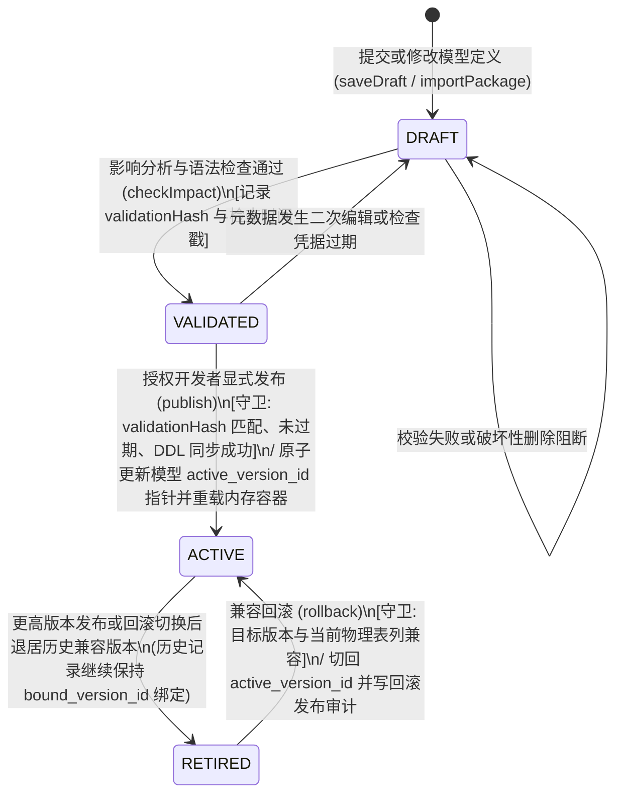
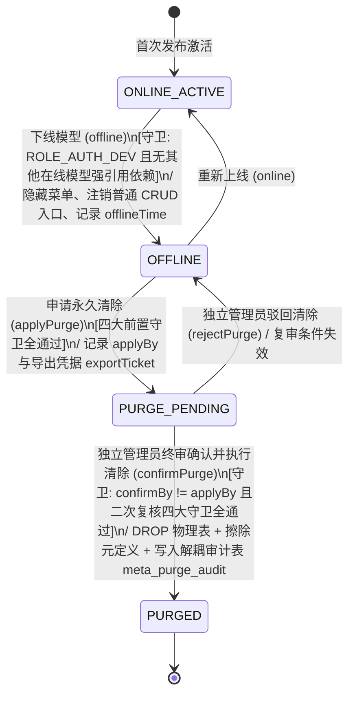
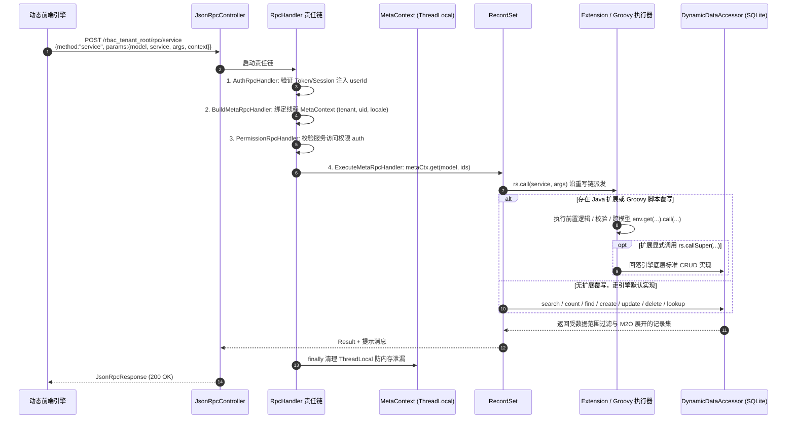

# 状态机与引擎运行时流转设计说明书
## 模型驱动开发的低代码平台（Java + DDD + JSON-RPC 2.0）

**文档版本**：v3.0（推倒重建版）  
**设计内容**：模型版本生命周期状态机（SM-01）、模型下线与双人清除状态机（SM-02）、JSON-RPC 责任链与方法重写链（SM-03）、平台通用声明式状态机引擎规范（SM-04）。

---

## 1. SM-01：模型版本候选与活动指针状态机

管理任意模型从 JSON 提交草稿、变更影响与引用检查、显式发布切指针、历史兼容退役到安全回滚的全过程。



### 1.1 状态转换守卫细节
1. **检查与发布分离（Two-Phase Safety）**：`DRAFT -> VALIDATED` 必须生成绑定当前候选快照哈希 `validationHash` 的影响报告。若提交 `publish` 时定义已被并发篡改导致哈希不匹配，拒绝切换 `active_version_id`。
2. **破坏性变更拦截守卫**：当新版本删除了某个字段 `f`，且上一 `ACTIVE` 版本中存在对 `f` 的视图列/搜索条件/按钮条件/关联引用（且 `f` 未声明 `display=false` 兼容退役）时，`checkImpact` 返回 `passed=false` 及所有具体引用位置列表，状态停留在 `DRAFT`。
3. **兼容回滚不丢数据**：`rollback` 仅修改模型聚合根的 `active_version_id` 与重新挂载对应版本的 `UiViewDef`/`ServiceDef`，**绝不执行 `DROP COLUMN` 或清空历史数据**。

---

## 2. SM-02：模型下线与双人复核安全清除状态机

防止生产运行中的元模型与物理表资产因单人误操作被不可逆销毁：



### 2.1 四大硬性守卫条件与双人互斥原则
发起 `applyPurge` 及终审 `confirmPurge` 时，系统均实时重新校验以下全部条件：
1. **保留期守卫**：`now - offlineTime >= retentionDays * 86400s`（默认为 0 或策略设定值，支持管理员在平台策略中配置测试/生产天数）；
2. **数据导出凭据守卫**：提交有效的 `exportTicket`（由模型数据导出接口 `exportPackageData` 生成并落库签发）；
3. **零外部引用守卫**：没有任何处于 `ONLINE_ACTIVE` 或 `OFFLINE` 的其他模型通过 `ManyToOne` 引用当前模型；
4. **零在途非终态数据守卫**：若模型包含 `status` 状态字段，不存在仍处于未完成/待处理中间状态的活跃记录（或根据配置要求清空确认）；
5. **双人互斥约束**：`confirmBy` 账号具备 `ROLE_ADMIN`，且 **`confirmBy != applyBy`**，同账号自审直接抛出 `-32004 ERR_DUAL_REVIEW_FORBIDDEN`。

---

## 3. SM-03：JSON-RPC 2.0 责任链与方法重写链时序

严格复刻 `sie-snest-engine` 的 `RpcHandler` 责任链与 `RecordSet.call / callSuper` 调用管道：



---

## 4. SM-04：平台通用声明式状态机能力

为兑现“不用为每个具体业务编写硬编码 Java Action”的低代码平台本质，平台引擎原生内置 **声明式状态转移服务 (`STATE_TRANSITION`)**：
开发者只需在模型的 `services` 数组中配置一条声明式动作定义：
```json
{
  "name": "approve",
  "displayName": "审核通过",
  "type": "STATE_TRANSITION",
  "auth": "approve",
  "transitionRule": {
    "statusField": "status",
    "fromStates": ["DRAFT", "PENDING"],
    "toState": "APPROVED",
    "guardScript": "row.amount > 0",
    "updateFields": { "approved_by": "${currentUser}", "approve_comment": "${args.comment}" },
    "errorMessage": "仅草稿或待审状态且金额大于0的记录可执行审核通过"
  },
  "paramsSchema": [
    { "name": "comment", "displayName": "审核意见", "dataType": "Text", "required": true }
  ]
}
```
引擎在调用 `{model}.approve` 时：
1. 开启本地数据库事务与乐观锁检查；
2. 校验当前记录 `statusField` 是否在 `fromStates` 内（拦截越态与重复提交，并支持幂等或报错配置）；
3. 若配置了 `guardScript`，交由 Groovy 表达式引擎求值判定；
4. 解析 `${currentUser}`、`${now}`、`${args.xxx}` 变量占位符并安全执行带版本号的 `UPDATE`；
5. 结合前端视图按钮 `enableCondition`、`paramsForm` 与服务端 `JsonRpcServiceResponse.message()` / `reloadWindow()` 指令，以及跨抽象父模型/扩展包 `rs.callSuper(...)` 与 `validate` 钩子，实现**“零 Java 代码开发一个完整状态流转业务系统”**。
